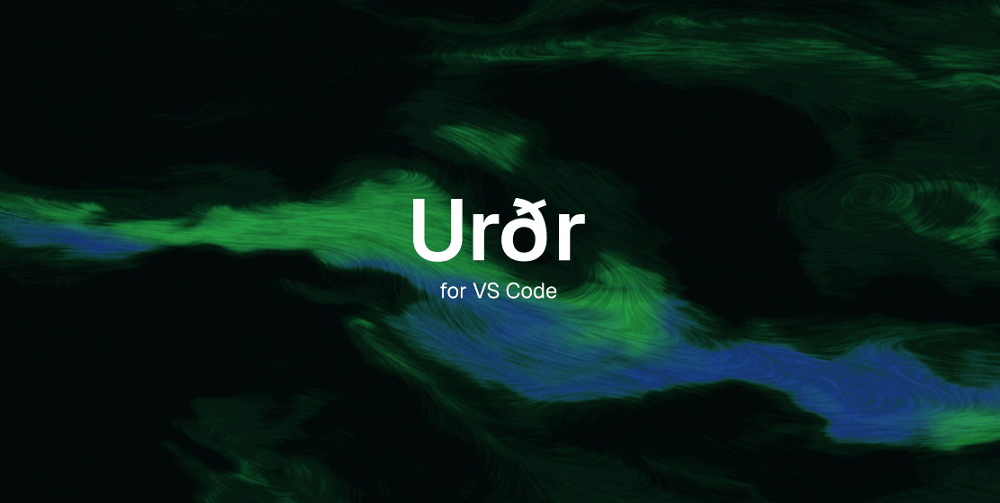

Urðr-XML checks TEI and other XML documents against their schemas as you
type, and checks XSLT, XQuery and XPath. It runs and previews XSLT
transformations, and it reads TEI ODD files as schemas.

It uses the engine of Urðr, an XML database for digital humanities work,
built into the extension as WebAssembly. You don't need Java, Saxon or an
Urðr server.

## Getting started

Install **Urðr-XML** from the Extensions view, then open an XML file that
names its schema. It works in desktop VS Code and in VS Code for the Web
(vscode.dev and github.dev). Problems show up in the editor and in the **Problems**
panel.

## Validation

A document is checked against the schemas it names:

- `<?xml-model?>` processing instructions, for RELAX NG (XML or compact
  syntax), Schematron and XSD;
- `xsi:schemaLocation` and `xsi:noNamespaceSchemaLocation`, for XSD 1.1;
- a `DOCTYPE`, for DTDs.

For example, a TEI document:

```xml
<?xml-model href="https://tei-c.org/release/xml/tei/custom/schema/relaxng/tei_all.rng"
            type="application/xml" schematypens="http://relaxng.org/ns/structure/1.0"?>
```

Schemas given by a web address are downloaded the first time and kept,
so the TEI schemas are read once. Turn this off with
`urdr.validation.fetchRemoteSchemas`.

XSLT 3.0 stylesheets and XQuery 3.1 modules are checked too, with the
stylesheets they include or import and the library modules they import.
They stop at the first error, as an XSLT or XQuery processor does, so
fix one to see the next.
In XSLT and XQuery, **Go to Definition** (`F12`), **Find All
References** (`Shift+F12`) and the **Outline** work for templates,
functions, variables, parameters, modes, keys and attribute sets, also
in the modules a stylesheet includes or imports, and in the library
modules an XQuery module imports. A function call goes to the
declaration with as many parameters, and a variable to the declaration
in scope. Going to the definition of a mode lists the templates in it.
References are found in the module, what it includes or imports, and the
open files that include or import it.

XQuery files also get syntax colours, which VS Code doesn't have on its own.
So does the XPath inside XSLT and Schematron: in `select`, `test`,
`match` and the other attributes that hold an expression or pattern, and
in the `{…}` of XSLT attribute value templates.

Many schema problems come with quick fixes (the light bulb, or
`Ctrl+.`), from what the schema allows there:

- add the required attributes a start tag lacks;
- change an element the parent doesn't allow to one it does, those the
  validator expected first, then the closest names;
- remove an attribute the element doesn't allow, or change it to a close
  name it does;
- change a value to one the attribute takes.

## Suggestions and hovers

While you type, the schema suggests the elements allowed at that point
(with their required attributes), attributes, attribute values and the
closing tag. Hovering over an element or attribute shows the schema's
documentation for it, such as the TEI Guidelines' description, along
with its attributes and what it may contain.

## Evaluate XPath

**Evaluate XPath…** runs an XPath 3.1 expression on the open document,
as Oxygen's XPath bar does. Names without a prefix are in the root
element's namespace, so `//p` finds TEI paragraphs; the root's prefixes
work too, and `tei:` in TEI documents. The results are listed with their
path and text. Moving through the list shows each node in the editor,
and Enter selects it. Values such as `count(//p)` are listed as they are.

## TEI ids

In TEI documents, an `xml:id` and the `#id` pointers to it (in `ref`,
`target`, `corresp`, `who` and any other attribute) are linked:

- **Go to Definition** (`F12`, or Ctrl/Cmd+click) on `#p1` goes to the
  element with `xml:id="p1"`, also in another file (`people.xml#ana`).
- **Find All References** (`Shift+F12`) lists every pointer to an id.
- **Rename** (`F2`) on an id or a pointer renames the id and every
  pointer to it in the document.
- After `#` in an attribute value, the document's ids are suggested.
- An id given twice is an error, and a `#id` that no element has is a
  warning.

## Editing elements

These actions work as in Oxygen XML Editor, with Oxygen's keys in XML
and XSLT files. Each is also in the Command Palette under **Urðr-XML**.

| Action | Windows, Linux | macOS |
|---|---|---|
| **Surround with Tags…**: wraps the selection in an element, choosing from those the schema allows there (the ones that may also hold the selection come first), or typing any name | `Ctrl+E` | `Cmd+E` |
| **Surround with the Last Tag** | `Ctrl+/` | `Cmd+/` |
| **Delete Element Tags**: removes the tags around the caret, keeping the content | `Alt+Shift+X` | `Cmd+Option+X` |
| **Split Element** at the caret, into two with the same attributes (but not the same id) | `Alt+Shift+D` | `Ctrl+Option+D` |
| **Join Elements**: joins the two elements on either side of the caret, when they have the same name and attributes | `Alt+Shift+J` | `Cmd+Option+J` |
| **Rename Element**: renames the start and end tag together | `F2` | `F2` |
| **Format and Indent**: see below | `Ctrl+Shift+P` | `Cmd+Shift+P` |
| **Select Element**: selects the element around the selection; again, the one around that | | |
| **Go to Matching Tag**: from a start tag to its end tag and back | | |

In XML files these keys replace VS Code's own: `Ctrl+E` (Quick Open),
`Ctrl+/` (comment lines; `Ctrl+K Ctrl+C` still comments) and
`Ctrl+Shift+P` (the Command Palette; `F1` still opens it). To keep
VS Code's keys, turn off `urdr.oxygenShortcuts`; the actions stay in the
Command Palette.

**Format and Indent** puts each element that holds only elements on
lines of its own, indented with the editor's tab settings. An element
that holds text, or that the schema lets hold text, such as a TEI `<p>`,
keeps its content as written, as adding line breaks there would add
text; so do `xml:space="preserve"`, `xsl:text` and CDATA. Tags, comments
and attributes stay as written. **Format Document** does the same.

**Expand Selection** (`Shift+Alt+Right`, `Ctrl+Shift+Cmd+Right` on macOS)
grows the selection by elements: the content, then the element, then its
parent's content.

The status bar shows where the caret is, as a path of elements such as
`/TEI/text/body/div[2]/p[3]`. Click it, or run **Copy XPath**, to copy
the path.

## TEI ODD files

A document can name an ODD as its schema:

```xml
<?xml-model href="myproject.odd" type="application/xml"
            schematypens="http://relaxng.org/ns/structure/1.0"?>
```

The extension compiles the ODD with the TEI Stylesheets (odd2odd, then
odd2relax) and checks the document against the result, including the
ODD's Schematron constraints. Suggestions and hovers use it too.

The first compile takes from a few seconds for a small ODD to a few
minutes for `tei_all`, with a progress note. The
result is kept until the ODD changes, also between sessions.

The TEI Stylesheets and the TEI P5 source (`p5subset.xml`, version
4.12.0) ship with the extension. To compile against another TEI version,
set `urdr.odd.source` to its `p5subset.xml`.

To save the schema as a file, right-click the `.odd` and choose
**Compile ODD to RELAX NG**.

## Transforming with XSLT

**Transform with XSLT…** runs a stylesheet on the current document. With
a stylesheet open, it asks for the document to run it on. The result
opens beside the document, or is written to a file. You'll find the
command in the Command Palette and on the right-click menu of XML and
XSLT files.

**Open XSLT Preview to the Side** (the preview button at the top right of
the editor) shows the result next to the document, and updates it as you
edit the document or the stylesheet, and when they or the files beside
them change on disk, such as after a `git pull`. HTML results are shown
as a page, as a browser shows it (on white, in the browser's fonts and
margins, not in the editor's theme), with scripts turned off. Pictures,
fonts and stylesheets load
from the workspace and from the web; a stylesheet linked by `http`
address, which the preview may not load itself, is read by the extension
and put in the page. Other results are shown as text.

The extension picks the stylesheet in this order:

1. a saved transform whose `source` matches the document;
2. the document's own `<?xml-stylesheet type="text/xsl" href="…"?>`;
3. otherwise it asks.

Save transforms in the workspace's `.vscode/settings.json`:

```jsonc
"urdr.transforms": [
  {
    "name": "Letters to HTML",
    "stylesheet": "xslt/letters-to-html.xsl",
    "source": "letters/*.xml",
    "output": "html/${fileBasenameNoExtension}.html",
    "parameters": { "title": "Letters" }
  }
]
```

Leave out `output` to open the result in an editor. A transform can also
set `initialTemplate` and `initialMode`.

`xsl:include`, `xsl:import`, `doc()` and `unparsed-text()` read from open
editors and from disk. `xsl:result-document` writes files next to the
output. `xsl:message` output goes to the **Urðr-XML: XSLT** output panel.

## Settings

| Setting | Default | |
|---|---|---|
| `urdr.validation.enabled` | `true` | Check XML documents against their schemas. |
| `urdr.validation.fetchRemoteSchemas` | `true` | Download schemas named by `http(s)` address. |
| `urdr.checkDelay` | `400` | Milliseconds to wait after typing stops before checking. |
| `urdr.transforms` | `[]` | Saved XSLT transforms (see above). |
| `urdr.transform.timeout` | `60` | Seconds a transformation may run before it is stopped. |
| `urdr.oxygenShortcuts` | `true` | Oxygen's keys for the element actions. |
| `urdr.odd.source` | | The `p5subset.xml` that ODDs compile against. Empty uses the bundled TEI P5 4.12.0. |

## Limitations

- In VS Code for the Web (vscode.dev, github.dev), schemas and
  stylesheets named by web address download only over https, from sites
  that let browser pages read them (CORS). For an `http` address the
  extension tries `https` first. Files in the workspace always work.
  When a download fails, the problem says why.
- `collection()` and `uri-collection()` aren't available in transformations.

## Reporting problems

Please open an issue on
[GitHub](https://github.com/urdr-db/vs-code-extension/issues) with the
document and schema (or a small part of them) that show the problem.

To build the extension yourself, see [CONTRIBUTING.md](CONTRIBUTING.md).

## License

MPL-2.0. The bundled TEI Stylesheets and TEI P5 source keep their own
licenses; see [extension/tei-stylesheets/README.md](extension/tei-stylesheets/README.md).
